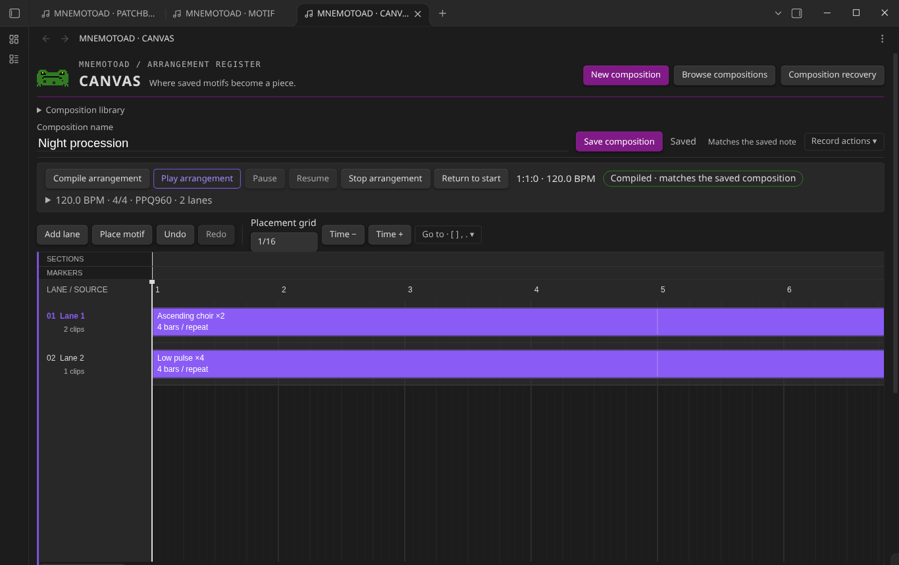
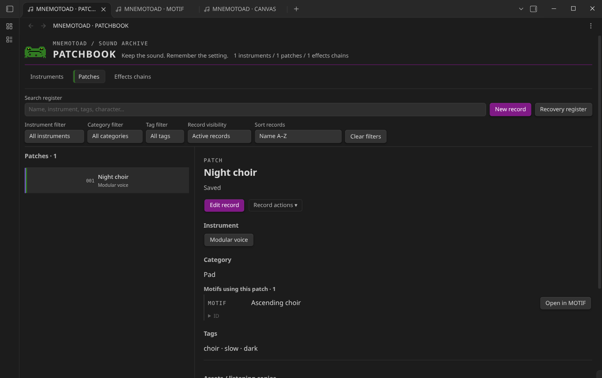
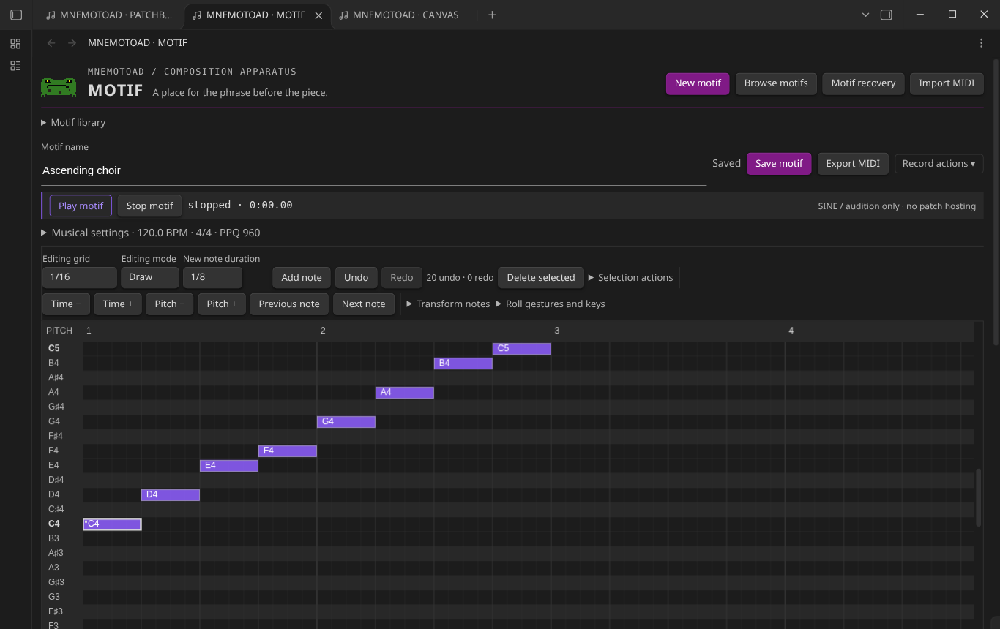
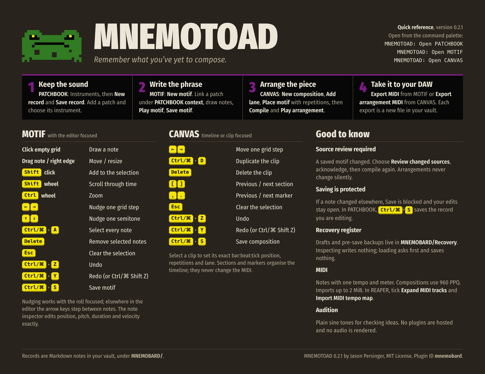

<div align="center">


# MNEMOTOAD

**_Remember what you’ve yet to compose._**

A local-first Obsidian plugin that keeps your sounds, sketches your musical ideas<br>and arranges them into pieces, all as plain Markdown in your vault.

[](https://github.com/jasonpersinger/mnemotoad/releases/latest) [](LICENSE) [](https://obsidian.md) [](#privacy-and-local-first-behaviour)

[**Download**](https://github.com/jasonpersinger/mnemotoad/releases/latest) · [**Quick reference (PDF)**](docs/quick-reference/MNEMOTOAD-quick-reference.pdf) · [**User guide**](docs/USER_GUIDE.md) · [**Release notes**](docs/RELEASE_0.2.1.md)

</div>

<br>



## From a sound to a song

MNEMOTOAD follows the path an idea actually takes, through three connected modules:

| | Step | What it’s for |
| :---: | --- | --- |
| **1** | **Keep the sound** in **PATCHBOOK** | Instruments, patches and effects chains, with the settings that made them sing. |
| **2** | **Write the phrase** in **MOTIF** | A piano roll for the riff, the hook, the eight bars you hummed in the car. |
| **3** | **Arrange the piece** in **CANVAS** | Lay saved motifs on lanes, repeat them, shape sections, and listen. |
| **4** | **Take it to your DAW** | Export standard MIDI and finish the track wherever you produce. |

MNEMOTOAD works *alongside* a DAW; it is not one. It doesn’t host instrument plugins or render audio files. It remembers the music so you can make it.

<table>
<tr>
<td width="50%"></td>
<td width="50%"></td>
</tr>
<tr>
<td align="center"><b>PATCHBOOK</b>: every patch knows its instrument, its effects and the motifs that use it.</td>
<td align="center"><b>MOTIF</b>: draw, nudge and audition a phrase, then save it as a note.</td>
</tr>
</table>

## Features

### 🎛️ PATCHBOOK: the sound library

- Three registers: **instruments**, **patches** and **effects chains**.
- **Instruments** record the manufacturer, type, platform or format, description and tags.
- **Patches** record their instrument, category, character, parameters and tags, and link to effects chains.
- **Effects chains** are ordered stages with parameter notes.
- Search, filter by instrument, category, tag or visibility, and sort. Records can be archived without being deleted.
- Link existing vault files (audio, screenshots, preset files), or import a confirmed copy of a local file. Preview one audio file at a time. Preset files are only inspected, never executed.
- Each patch lists the motifs that use it.

### 🎹 MOTIF: the phrase workshop

- A piano roll: draw, move and resize notes, select several, and build chords. Edit any note exactly in bar:beat:tick and ticks.
- Transformations: transpose, quantize starts and set velocity, with full undo and redo.
- Tempo, meter and PPQ per motif (new motifs use 120 BPM, 4/4, 960 PPQ).
- **Audition** with a simple sine tone, for checking a phrase. It is not a synthesizer.
- **MIDI import**: choose one track and channel. The source PPQ is kept, and anything that can’t be represented is reported before import.
- **MIDI export** to a new file.
- Link a motif to a PATCHBOOK patch, and jump between the two.

### 🗺️ CANVAS: the arrangement table

- Lanes of saved motifs, placed by exact bar:beat:tick, with repetitions. Clips can be moved, duplicated, deleted or moved between lanes.
- Sections, markers and references to recordings in the vault, for organisation only. They never change the MIDI.
- **Compile** to exact MIDI events, **audition** the arrangement (play, pause, resume, stop), and **export multitrack MIDI** (Type 1).
- **Source-revision protection:** when a saved motif changes, CANVAS asks you to review and acknowledge the change before compiling again. An arrangement never changes behind your back.

## Quick reference

<a href="docs/quick-reference/MNEMOTOAD-quick-reference.pdf"></a>

A one-page, dark-mode card with the workflow, every keyboard shortcut and the essentials. Download the [PDF](docs/quick-reference/MNEMOTOAD-quick-reference.pdf) to print or keep beside your piano roll.

## Installation

> MNEMOTOAD is not in the Obsidian community plugin directory yet. Install it manually; it takes about a minute.

1. Download `main.js`, `manifest.json` and `styles.css` from the [latest release](https://github.com/jasonpersinger/mnemotoad/releases/latest). Each release lists SHA-256 checksums. You can also build them with `pnpm install && pnpm build`.
2. Copy them into `<vault>/.obsidian/plugins/mnemobard/`. The folder name is the plugin ID; see [Compatibility identifiers](#compatibility-identifiers).
3. In **Settings → Community plugins**, turn off Restricted mode if prompted, then enable **MNEMOTOAD**.

**Requirements:** Obsidian **1.15.0** or later, on desktop (the plugin is marked desktop-only). Validated on **Linux**; Windows and macOS have not been validated yet.

**Upgrading from MNEMOBARD 0.1.0 or MNEMOTOAD 0.2.0:** replace the three files in the same folder and restart Obsidian. Records, settings, recovery checkpoints, hotkeys and open views carry over; nothing is migrated or rewritten.

## Basic usage

1. **MNEMOTOAD: Open PATCHBOOK** → Instruments → **New record** → **Save record**. Then create a patch and choose its instrument.
2. **MNEMOTOAD: Open MOTIF** → **New motif**. Under **PATCHBOOK context**, link the patch. Add notes, **Play motif**, then **Save motif**.
3. **MNEMOTOAD: Open CANVAS** → **New composition** → **Add lane** → **Place motif**, and set the repetitions. Then **Compile arrangement**, **Play arrangement** and **Save composition**.
4. Export with **Export MIDI** (MOTIF) or **Export arrangement MIDI** (CANVAS).

The [user guide](docs/USER_GUIDE.md) covers everything else.

## Your data, your vault

**Storage.** Records are Markdown notes with YAML front matter; motifs and compositions also carry a fenced JSON data block. They live under `MNEMOBARD/` in your vault:

- `Instruments/`, `Patches/` and `Effects Chains/`
- `Motifs/` and `Compositions/`
- `Assets/` for imported copies
- `Exports/` and `Recovery/`

Your own writing in a note’s body, and any unknown front-matter fields, are kept on every save. MNEMOTOAD never modifies, moves or deletes your audio, presets or imported MIDI.

**Backup and recovery.**

- Saving is explicit (a Save button or Ctrl/Cmd+S) and protected. If a note changed on disk since you opened it, Save is blocked and your edits are kept.
- Unsaved drafts and pre-save backups are written as checkpoints in `MNEMOBARD/Recovery/`. They are never deleted or pruned automatically.
- The **recovery register** in each module lets you search and inspect checkpoints read-only. Loading one needs explicit confirmation and only opens an unsaved draft.
- Your vault is your backup unit: back it up as you would any other notes.

## MIDI interoperability

- **Data:** notes, with one tempo and one meter per motif or composition, at exact integer ticks. Compositions use 960 PPQ.
- **Import limits:** 2 MiB, 128 tracks and 50,000 events.
- **Export:** always a new file. Arrangement exports are Type 1: a conductor track, then note tracks for the lanes that contain notes, keeping the composition’s full length.
- **Tested in REAPER 7.84 on Linux:** tick *Expand MIDI tracks* and *Import MIDI tempo map* when importing. REAPER trims each item to its last note; the file keeps the full length. Other DAWs have not been tested.

## Privacy and local-first behaviour

No account, telemetry, analytics, network access or synchronisation. MNEMOTOAD makes no network requests.

MNEMOTOAD reads and writes inside your vault, and only when you act. **Files outside the vault** are read in exactly two cases, and only for a file you choose yourself in the system file picker:

- **PATCHBOOK → Manage assets → import a local file:** the chosen file is read once, and a copy is written into your vault after you confirm the destination.
- **MOTIF → Import MIDI → choose a local MIDI file:** the chosen file is read for preview and import.

The original file is never modified, moved or deleted, and nothing outside the vault is ever written. Preset and other files are never executed.

## Known limitations

- MNEMOTOAD is not a DAW. Audition uses sine tones and is not equivalent to an external synthesizer. MIDI export contains no rendered audio.
- Instrument and patch records are organisational references; sounds are not hosted or loaded.
- Fixed tempo and meter; no controllers, program changes or pitch bend.
- Windows, macOS and screen-reader use have not been validated.
- Internal storage identifiers keep the former name MNEMOBARD for compatibility (below).
- More in the [user guide](docs/USER_GUIDE.md#known-limitations) and [known issues](docs/KNOWN_ISSUES.md).

## Compatibility identifiers

The product was named MNEMOBARD before 0.2.0. These identifiers keep that spelling so existing vaults keep working:

| Identifier | Reason |
| --- | --- |
| Plugin ID `mnemobard` | Keys the plugin folder, settings and enabled state |
| View types `mnemobard-*` | Saved layouts reopen views by type |
| Command IDs `mnemobard:open-*` | Hotkeys are bound to them |
| Folder `MNEMOBARD/` | Existing records live there |
| Front-matter keys `mnemobard_*`, data blocks `mnemobard-motif` / `mnemobard-composition` | The storage format |
| Recovery formats `mnemobard-recovery`, `mnemobard-editor-draft` | Existing checkpoints stay readable |
| MIDI conductor track name `MNEMOBARD conductor` | Part of the exact exported bytes |

## Development

```sh
pnpm install
pnpm check          # typecheck + lint + tests + production build
pnpm dev:vault      # deploy into the marked disposable dev-vault/
pnpm dev:obsidian   # isolated Obsidian for native checks
```

See [DEVELOPMENT.md](docs/DEVELOPMENT.md), [ARCHITECTURE.md](docs/ARCHITECTURE.md) and [AGENTS.md](AGENTS.md). The brand colours and the mascot are described in [BRAND.md](docs/BRAND.md). The quick reference is generated by `scripts/quick-reference.mjs`.

<br>

<div align="center">


**MNEMOTOAD** by Jason Persinger · [MIT License](LICENSE)<br>
<sub>Bundled third-party code (`yaml`, ISC; `midi-file`, MIT) is listed in <a href="THIRD_PARTY_NOTICES.md">THIRD_PARTY_NOTICES.md</a>.</sub>

</div>
