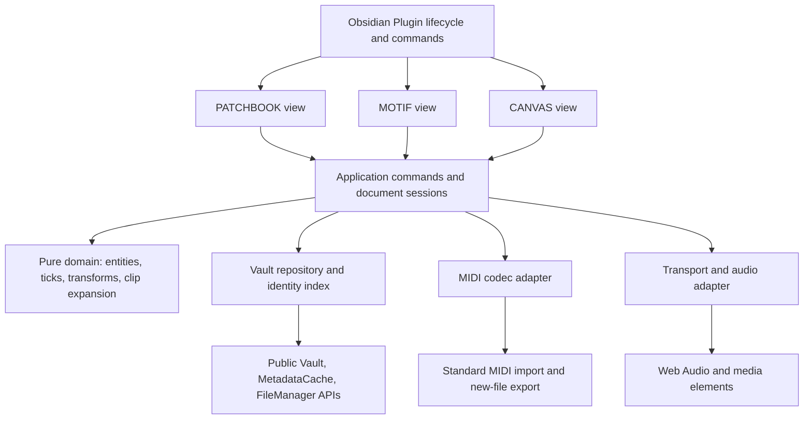
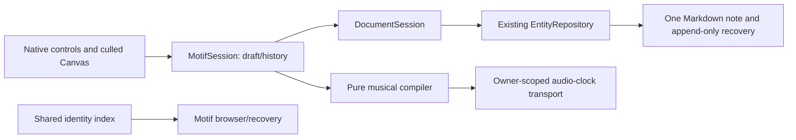
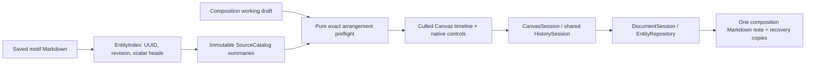

# Architecture proposal

Milestone 4A status: Prompt008 authorizes CANVAS arrangement planning after 3B review. The implementation uses saved live motif references, exact PPQ preflight, shared history and safe Markdown persistence. PATCHBOOK/MOTIF and experiments remain intact. Arrangement playback, multitrack export and channel allocation are deferred to separately authorized 4B. See [MILESTONE_4A_REPORT.md](MILESTONE_4A_REPORT.md); historical proposals below are qualified by the implemented milestone sections.

## Recommended stack

| Area | Recommendation | Rationale |
| --- | --- | --- |
| Language/host | Strict TypeScript; public Obsidian Plugin API | Typed musical contracts with a narrow host adapter. |
| Tooling | pnpm with reviewed lockfile; esbuild; separate `tsc --noEmit`; ESLint with Obsidian rules | Small build surface and compatibility with official sample patterns. Exact versions selected at Milestone 1. |
| UI | Obsidian ItemViews and controls; vanilla TypeScript DOM shell; Canvas 2D grids | Native forms and low dependency cost; culling and hit-testing under our control. No evidence yet requiring a framework. |
| Sound | One owner-scoped musical transport with a lazy context per active audition; separate mutually exclusive media preview | Offline audition without sample licensing, remote soundfonts, or external instruments; Stop releases the context. |
| MIDI | `midi-file` behind a typed codec; domain owns note pairing/time/arrangement rules | Low-level event access, declarations, and no runtime dependencies in inspected manifest. Final approval depends on fixtures/license review. |
| Data | Markdown/YAML identity; one owned versioned JSON block per motif/composition | A single authoritative text file per entity reduces save consistency problems. Standard MIDI is an explicit derivative. |
| Tests | Vitest for pure logic and repository contracts; browser interaction/performance tests; disposable Obsidian vault integration | Simulated DOM tests cannot validate audio, layout, or Electron lifecycle. |
| Version control | Local Git in Milestone 1 after approval | No Git initialization, commits, or remote setup in Milestone 0. |

The [research](TECHNICAL_RESEARCH.md) compares libraries and UI alternatives. The official sample currently demonstrates a TypeScript/esbuild CommonJS build and excludes the host API from the bundle; MNEMOBARD should follow that delivery contract while pinning compatible tools. [Sample build](https://raw.githubusercontent.com/obsidianmd/obsidian-sample-plugin/master/esbuild.config.mjs).

## Milestone 1B evidence and proposed refinement

`experiments/` is a separate dependency graph. `timing.ts` retains exact rational quarter positions derived from integer source PPQ, integrates/inverts tempo maps, and rejects SMPTE timing explicitly. `compiler.ts` produces immutable ordered rational-tick/seconds on/off events with track/channel/patch references. The compiler does not read entity files. `transport.ts` consumes these events through an injected audio-clock sink/timer; `web-audio.ts` supplies only a quiet test tone. Geometry/index/rendering are independent of storage and musical compilation. A separate disabled-by-default experimental plugin verifies ownership in the marked disposable vault, including pending-frame cancellation.

Recommended production direction, pending review: retain 960 editing ticks and original source PPQ; use exact intermediate positions until explicit integer export/quantization. Keep fixed-tempo schema 1; tempo-map support here is a feasibility test, not permission to persist maps or migrate records. Existing endpoint-rounding/minimum-duration/warning rules remain the proposed integer-export contract; the prototype has no complete export preflight/adapter. See [DATA_MODEL.md](DATA_MODEL.md#milestone-1b-timing-boundary).

Prefer a shared culled Canvas 2D grid with native DOM controls/inspectors and a separately designed accessible list. Shared viewport/index/hit geometry can serve note rows and arrangement lanes. Native 20k-total/501-visible Canvas work was small; the dense 20k-visible case approached a frame budget. All-DOM 20k failed the native harness; this is evidence against this all-node implementation, not a universal SVG/DOM limitation. Grid layers, committed-gesture reindexing, visual-density policies, undo/session ownership and accessibility still need production design.

Native audio supports the proposed 25ms poll/100ms horizon with explicit stop on lateness/stall, generation cancellation and owner-close cleanup. Poll wall time and AudioContext time are distinct; measured scheduling lead is not audible latency. A production transport should have one shared owner/focus coordinator rather than the experimental view's own context. Tone.js, rendering frameworks and legacy extraction remain unnecessary for these experiments. `midi-file` is dev-only and provisionally preferred behind a strict outer parser validator; no runtime dependency was added.

## Boundaries and dependency direction

### Implemented PATCHBOOK boundary (2A)

`src/modules/patchbook/library.ts` owns library queries, stable-ID association choices, archive/restore and shared per-ID sessions. `query.ts` supplies pure search/filter/sort over derived library items. `session.ts` owns cloned drafts, explicit Save, revision tracking, debounced recovery checkpoints and subscriber/timer cancellation. `form.ts`/`view.ts` supply native controls in the existing PATCHBOOK ItemView type. The view subclasses ModuleView to retain its workspace/lifecycle contract while replacing that module's placeholder.

All authoritative operations continue through EntityRepository → source-preserving codec → public Vault adapter. Instrument/effects-chain kinds and namespaced optional patch properties extend schema1 additively; no note is converted on open. Workspace state contains query/selection hints, never the sole copy of drafts. Reverse patch lists are derived, not written to instruments/chains. No database, event bus, UI framework or runtime dependency was added.

Library removal is confirmed **archiving**, a conditional metadata update with reversible restore. Notes/IDs/incoming references remain. Permanent deletion is a separate native Obsidian action; no atomic compare-and-trash or cascade is claimed. See [data contracts](DATA_MODEL.md#milestone-2a-library-records).

Authoritative edits require explicit Save. Unsaved draft checkpoints run after500ms and before navigation/module disable/view closure; temporarily invalid form values are preserved as recovery JSON by the same repository. A checkpoint is not a saved entity. Save failures retain the draft and disk version. Plugin unload cancels resources without attempting asynchronous durability work; edits after the last confirmed save/checkpoint are not crash/unload-durable. Recovery copies are manually inspectable, not silently restored.

ItemView owns scoped index/session subscriptions and an Obsidian Mod+S binding. Closing releases handlers immediately, then checkpoints while shared services remain alive. Module disable awaits dirty checkpoints before changing settings/detaching its views, retaining sessions/files. Plugin unload disposes sessions/timers. Native links open through workspace APIs; no asset is decoded, executed, imported or previewed in2A.



Future conceptual layout, not created directories:

```text
src/main.ts                    plugin composition root
src/domain/                    musical entities, validation, timing, transforms
src/application/               commands, document sessions, export coordination
src/platform/obsidian/         vault, links, settings and lifecycle adapters
src/infrastructure/midi/       selected library adapter
src/infrastructure/audio/      audio-clock transport and preview
src/modules/patchbook/         search and record UI
src/modules/motif/             piano-roll UI and editor commands
src/modules/canvas/            arrangement UI and commands
src/ui/                        grid geometry, viewport, accessible controls
tests/                         domain, storage, fixtures and integration harness
```

PATCHBOOK owns patch editing; MOTIF owns motif editing; CANVAS owns composition editing. All reference shared domain entities. No view reaches into another view, private host internals, or raw filesystem paths. CANVAS consumes motif records through the repository and expands clips through the domain. Disabling MOTIF removes its editor commands/UI while composition preview/export can still read motif data. Shared services remain available while consumers need them. PATCHBOOK can operate with both other modules disabled.

## Shared service contracts

These are responsibilities and proposed interface shapes, not implemented APIs.

| Service | Consumes → produces | Ownership and constraints |
| --- | --- | --- |
| EntityRepository | entity ID/path and expected source fingerprint → validated record or conflict/error | Per-file serialized writes; optimistic expected-content check; durable save acknowledgment. |
| IdentityIndex | vault create/modify/rename/delete and metadata events → ID/path index plus diagnostics | Derived, rebuildable; duplicate IDs never resolve arbitrarily. No business data in plugin settings. |
| LinkService | entity ID + note context → resolved file and native link | IDs authoritative; Markdown links provide navigation; missing/ambiguous targets retained. |
| DocumentSession | validated base record + edit commands → shared immutable draft, undo stack, saved status | One session per entity in the main app window, multiple view subscribers; session token prevents stale async completion. |
| MidiCodec | byte array ↔ explicit event data | No filesystem, UI, audio, network, or implicit tempo assumptions. |
| MidiImportService | parsed events + user choice → new motif + warnings | Validates limits and unsupported data; originals untouched. |
| ArrangementCompiler | validated composition + captured motif records → ordered note/meta events | Pure deterministic clip expansion; shared by preview and export. |
| Transport | compiled events + tempo + audio clock → scheduled voices and position | One active musical transport; explicit owner, cancellation generation, stop/release. |
| AssetService | vault-relative reference → safe resource URI or missing status | No Node `fs`, no automatic external file access, no auto-execution of presets. |
| AudioPreviewService | selected supported vault audio → media playback | Preview-only; pauses previous preview, bounded resources, no composition sync in MVP. |
| RecoveryService | prior content + pending draft + failure → recoverable candidate files | Unique new files; validation before restore; no silent overwrites or automatic deletion. |

### Communication and state

Use direct typed application commands for edits and results; scoped typed subscriptions for document snapshots and diagnostics. Avoid a global untyped event bus or dependency on an external state framework. Cross-module coordination goes through IDs and services. Persist only musical data; selection, hover, viewport, transport position, and undo are transient. Workspace view state may retain entity ID and viewport hints, never the sole copy of a draft.

During drag, preview locally in the controller and render with `requestAnimationFrame`; commit one undoable domain command when the gesture ends. Do not serialize or broadcast a full document on every pointer move. Persistent edits schedule debounced saves, proposed 500 ms after an edit; Save commits immediately. Show dirty/saving/error states. A visible Saved state is the normal-restart durability boundary. Crash recovery of edits before that boundary is best-effort and explicitly labeled.

Multi-view editing in one app window shares a session. External editors, sync clients, and additional Obsidian windows are competing writers; detect them with content checks. A queue in this plugin is not a cross-process lock.

## Persistence and relationships

The [data model](DATA_MODEL.md) defines authoritative fields, native links, generated exports, and version handling. Read display data using caches where appropriate; perform writes through public Vault/FileManager interfaces. Use `Vault.process` for whole-text conditional mutation; use `processFrontMatter` for patch metadata-only edits. Both have a per-file boundary, not a vault transaction. [Vault guide](https://docs.obsidian.md/Plugins/Vault), [frontmatter API](https://github.com/obsidianmd/obsidian-developer-docs/blob/main/en/Reference/TypeScript%20API/FileManager/processFrontMatter.md).

Proposed save sequence:

1. Validate the draft and the expected schema; compute a candidate in memory, preserving user prose and unknown fields.
2. Serialize writes for that entity. Preserve the previously read bytes as a uniquely named recovery file before replacement; abort the replacement if required backup creation fails.
3. In the synchronous `Vault.process` callback, compare current text with the session’s expected base; replace only if it matches. Otherwise retain the disk version and the draft and surface a conflict. Regenerate no unrelated Markdown.
4. Await success, update the session base, and publish Saved. If the call fails, retain dirty state; if outcome is ambiguous, reread before retrying. Ignore stale completion tokens.
5. Refresh derived indexes and relationship displays. Failure of a derived summary is repairable and does not roll back the authoritative entity.

This is conflict-aware persistence, not an operating-system crash-durable transaction guarantee. A process/power failure can leave a partial file; validated recovery copies and explicit restore are required. Do not depend solely on Obsidian File Recovery or on async work in `onunload`.

Entity creation writes a complete new note with unique ID/path. Attachments are selected from the vault or copied to a new collision-free path only in a future user-invoked import operation. Cross-file link summaries are derived; no bidirectional authoritative relationship needs a multi-file commit. On restart, an incomplete creation remains a diagnosable orphan rather than causing deletion.

Native links in bodies/frontmatter aid graph and navigation. JSON ID references remain authoritative when notes move. Obsidian cannot be assumed to rewrite arbitrary JSON links. Rebuild IDs on startup; react to rename events, update known asset path hints conditionally, and flag unresolved moves occurring while the plugin was disabled. Never infer a new asset from its basename alone.

## MIDI and audio flow

Import reads bytes → bounded codec parse → format/timing validation → event pairing and conversion → explicit warnings/track selection → new motif note. Export captures composition and referenced motif records, fingerprints/rechecks the read set, freezes that validated snapshot, expands repeats, orders events, serializes SMF, and creates a new file. Abort/retry if any source changed during capture; disclose that external writers can still change files afterward. The export represents the captured snapshot.

Transport uses integer ticks with explicit source PPQ mapped to seconds, one audio-clock origin, and a proposed 25 ms scheduling poll with a 100 ms horizon. These are experiment settings, not timing guarantees. Schedule note starts/stops with audio node time arguments; render playhead separately. On seek or loop, cancel the previous generation and release active voices. Bound polyphony (proposed 64 audition voices) with a documented oldest-voice policy; MIDI export is unaffected. Under a scheduling underrun or suspended host, stop with an explanation instead of bunching late notes. Legacy lookahead is 150 ms and lacks that late-event policy; adopting its transport requires a deliberate change.

Instantiate AudioContext only from a user playback gesture. Resume if permitted; report suspended/unsupported states. A basic audition voice uses oscillator and gain envelope and does not reproduce a linked patch. Long audio previews use an HTML media element with a vault resource URI; do not decode the entire sound library. A small shared audio-focus coordinator stops the current transport before starting a patch preview and pauses that preview before musical playback. Recordings remain unsynchronized references in the MVP. The [Web Audio scheduling tutorial](https://developer.mozilla.org/en-US/docs/Web/API/Web_Audio_API/Advanced_techniques) motivates clock-based scheduling; host performance still needs measurement.

## UI rendering

Use separate layers for static grid, visible notes/clips, selection, and playhead, with an explicit musical-coordinate transform. Cull outside the viewport and query hit candidates by time range and pitch/lane; avoid a DOM node for every note. Zoom remains centered on a chosen musical location. Device-pixel ratio affects backing store, not musical coordinates. An accessible DOM note/clip list uses the same commands as the grid. Rendering, snapping, and hit-testing never own persistent state. Read computed theme tokens into canvas styles when appearance changes.

## Lifecycle and configuration

1. `onload`: validate `loadData` settings, construct lightweight services, register view factories/commands/settings, and register lifecycle-bound events. Unknown future settings are preserved and not downgraded.
2. On layout readiness: build the identity index incrementally, wait for relevant metadata readiness, and resolve restored entity IDs. Respect deferred views; do not force all hidden views to initialize.
3. `onOpen`: attach view-scoped controllers/subscriptions/observers; render the requested session. Never maintain a plugin-wide view singleton.
4. Module disable/view close: end owned gestures; stop transport if owned; dispose view resources. Save during normal editing and initiate ordinary close-time persistence where possible; retain conflicts/recovery data if a close save fails. Never claim unload can reliably await pending saves.
5. Plugin unload: prevent new commands, invalidate pending work, stop/release audio, clear timeouts/intervals/animation frames, disconnect observers, remove subscriptions, terminate any workers, revoke only created object URLs, and close context/resources. Do not detach workspace leaves in `onunload`.

Use Component cleanup registration and explicit disposables for APIs it does not own. Host guidance covers lifecycle ownership and deferred views. [Lifecycle guide](https://docs.obsidian.md/plugins/guides/lifecycle-management), [deferred views](https://docs.obsidian.md/plugins/guides/defer-views), [plugin guidelines source](https://github.com/obsidianmd/obsidian-developer-docs/blob/main/en/Plugins/Releasing/Plugin%20guidelines.md).

Settings hold module flags, creation folders, default tempo/meter/snap, preview level, and recovery preferences. Entity tempo/meter belongs in entity files. Initial manifest should be desktop-only as a product support boundary; browser-based domain/asset adapters leave future mobile evaluation possible. Choose `minAppVersion` from tested APIs and installer versions, not from a copied sample value. Pop-out windows require explicit test coverage; until then, present an explanation and open editors in the main app window.

## Testing, recovery, and migrations

Pure domain tests cover note bounds, beat math, transforms, repeated clips, channel conflicts, deterministic export, and supported import fixtures. Repository tests simulate out-of-order saves, external edits, malformed/future schemas, partial writes, duplicate IDs, and unavailable assets. Real browser tests cover pointer/keyboard equivalence, DPI, focus, and culling. Disposable-vault tests cover metadata, rename, workspace restore, and unload. OS loopback tests distinguish audible timing from scheduled times. See [ROADMAP.md](ROADMAP.md) and [RISKS.md](RISKS.md).

Migrations are pure version-to-version transforms, separate from loading. Preview proposed changes, back up exact original bytes, obtain migration approval, validate output, and conditionally write one entity at a time. Preserve unknown fields and user text; stop on a failed entity. A migration journal records progress and makes retry idempotent. Future schemas remain read-only. Recovery restores to a new file first, validates it, and lets the user review replacement. No automated cleanup of original assets or recovery files in the MVP.

## TROUBADOUR integration boundary

The [completed static audit](TROUBADOUR_AUDIT.md) recommends hybrid A+C: selected refactoring plus reference-informed rebuilding. No component is currently approved for copying. Proposed placements are:

| Legacy candidate | New boundary | Required changes |
| --- | --- | --- |
| `core/music.ts`, `core/note-edit.ts` | Pure domain musical math/edit commands | New note/length types, explicit PPQ, no old 8-bar/512-note ownership limits. |
| `core/document.ts`, selected `VaultStore`/`Draft` logic | Codec, repository and document sessions | New envelopes, expected-content policy, incremental indexing and pre-save backups. Preserve tested prose/race behavior. |
| `audio/voices.ts`, `levels.ts`, selected transport logic | Narrow Web Audio adapter | Review rights, split A/B/mobile policy, add underrun/seek/resource tests and new playback limits. |
| Selected legacy tests/synthetic fixtures | Contract/fixture tests | Adapt expectations and verify provenance; no existing vaults/artifacts/configuration copied. |
| `core/development.ts` | Later domain transforms | Separate post-MVP feature/reuse approval. |

Imported motif source PPQ should remain exact, as legacy fixtures demonstrate; composition compilation converts to its explicit PPQ with diagnostics. The new piano-roll renderer, patch catalog, standalone entity graph, lane compiler and Type1 exporter are new work. The old all-vault refresh, DOM piano roll, section clipping, entity graph, build system and lockfile are not adopted. Every authorized extraction needs clear licensing/provenance and MNEMOBARD contract tests; [L1–L5](DECISIONS.md#proposed-legacy-authorization-groups) define the proposed review scope.


## Implemented PATCHBOOK asset/recovery boundary (2B)

`storage/asset-port.ts` adds file metadata, transient resource URLs and binary creation to the same `ObsidianVaultPort`; authoritative entity updates still use EntityRepository. `patchbook/assets.ts` resolves native links, validates associations, and copies explicitly selected browser File bytes to a new vault path. Import confirmation, collision handling, cancellation and uncertain-copy reporting do not imply cross-file transactions. No raw runtime filesystem, fetch, separate database or legacy/experiment import.

`preview.ts` owns one lazy HTMLAudioElement, generation-guarded play/resume promises, load timeout, pause/seek/stop and listener/source cleanup. It streams a chosen local resource on request; no AudioContext, synth or library-wide decoding. An AssetPanel owns its subscriptions/import cancellation and preview owner token; navigation/form replacement/close/disable/unload stops that token. Other views cannot stop another owner's playback with scoped controls. A future musical transport must explicitly coordinate focus; it is not implemented here.

`recovery.ts` reads existing append-only formats through the vault port, bounds discovery and resolves original records by UUID. `recovery-panel.ts` inspects exact source/draft text and requires explicit loading. Loading creates a dirty shared LibrarySession; saving still uses the same conditional repository. Changed sources require an explicit comparison acknowledgment and a freshly verified displayed base. Later competing edits still conflict. This Prompt005 workflow supersedes the older proposed new-comparison-note restoration path: no duplicate authoritative entity is created merely to inspect recovery.

A revision-keyed catalog snapshot avoids cloning every record before every filtered query. Public results remain cloned; index publication invalidates the snapshot, including renames/duplicates. This is a derived in-memory cache, never a second authority. Sorting/materialization remains linear. See the report's bounded benchmark and limitations.

The ItemView scope is constructed before host activation, with handlers registered/removed per opening. Presets/arbitrary extensions open in a bounded inert Obsidian Modal; recognized audio/image extensions can open in the native workspace. No OS shell opener is called. Final design and musical technology decisions are unchanged.

## Implemented MOTIF boundary (3A)

Prompt006 approves B01–B03 directions within3A. `src/modules/motif/` contains pure commands, a bounded `MotifSession`, index-backed `MotifLibrary`, CSS-pixel geometry/interval index, renderer, pointer/scroll controller, numeric/list inspector and native view. `src/music/` contains reviewed exact timing, a new pure deterministic event compiler, injected owner-scoped transport and lazy sine adapter. Musical data never depends on pixels or Obsidian. Canvas/playhead frames never determine audio timestamps.



`DocumentSession<T>`, `CheckpointRecovery<T>` and the recovery inspector extract existing PATCHBOOK behavior into shared code with narrow typed validators. PATCHBOOK wrappers preserve its contracts/UI. MOTIF recovery refuses other entity kinds. Repository/index/codec/settings remain common; there is no second writer, global event bus or new dependency. Optional motif description/notes extend schema1 without migration.

Main owns one musical transport and one recorded-preview service, coordinating exclusive focus. The musical context is created on Play and closed on Stop/error/owner change/close/module disable/unload. Notes receive automatic audio-thread end scheduling when started, with explicit off events retained in the compiler. View observers, frames, pointer/key listeners and focus-bound key scopes are disposed. Ordinary view transitions retain shared drafts/history; plugin unload disposes sessions and never promises a final durable save.

Unsupported map metadata is retained and diagnosed, not flattened. Same-pitch overlaps retain the existing rejection rule; different-pitch polyphony works. No MIDI codec, tempo-map editor or arrangement feature is implemented. The own1B lab stays unchanged and outside the production import graph. See the [3A report](MILESTONE_3A_REPORT.md) for adoption decisions, tested bounds, actual performance and remaining lifecycle/platform limits.

## Implemented MIDI and integration boundary (3B)

Prompt007 evaluates/adopts B04 within a conservative SMF subset. `src/midi/structure.ts` strictly bounds/frames bytes before `import.ts` invokes pinned midi-file decoding and pairs selected track/channel notes. `worker.ts`/`job.ts` keep untrusted decoding in a cancellable10-second local worker; its bundle is embedded in main.js and URLs are revoked. No source bytes/remote assets execute. Preview selection and classified blocking/acknowledgment precede a fresh unsaved MotifSession; the normal repository Save alone creates the musical note.

`export.ts` consumes the existing pure compiler at source PPQ, produces deterministic Type1 conductor/note tracks and rechecks framing. Its consumer polyphony bound128 is separate from audition's existing64 default. `MidiFiles` creates only new visible vault `.mid` derivatives through public APIs; no competing entity writer or overwrite exists. Independent Python/raw-byte fixtures validate events rather than trusting the same codec in both directions.

MOTIF commands implement validated group transpose/quantize/velocity within existing history. `positions.ts` uses exact fractions for one-based denominator-beat notation, retaining zero-based source ticks. `PatchAssociation` uses existing patchId/patchLink fields and index; public loadIfDeferred precedes PATCHBOOK navigation. No PATCHBOOK UI redesign or sound hosting occurs.

Attached views pin sessions. Eviction removes only clean idle unowned in-memory sessions until eight remain; dirty/busy/owned sessions and all files/checkpoints stay intact. Measured refresh optimization captures one immutable draft per update and leaves library refreshes index-driven. Existing validation/snapshot history are unchanged. See the [3B report](MILESTONE_3B_REPORT.md) for bounds, resource ownership, fidelity rules, before/after full-view measurements and limits. CANVAS/tempo-map/multitrack editor design remains separately gated.

## Milestone 4A implemented arrangement foundation

CANVAS is a native `CanvasView`, backed by `CanvasLibrary` and `CanvasSession`. `HistorySession<T>` extracts the existing MOTIF history into a shared implementation; MOTIF retains its selection behavior and history semantics. PATCHBOOK continues using its existing document sessions. Position/grid utilities and Canvas backing-size math are shared pure modules, with compatibility exports at the old MOTIF paths.



`src/arrangement/` is independent of Obsidian, DOM and audio. A cached summary contains PPQ, complete length, tempo/meter, note count, source-text SHA256 and the GCD of note endpoints/full length. It retains no notes. Pure timing checks exact conversion with BigInt, and preflight returns parametric periods/extents and structured diagnostics. It never allocates channels, expands MIDI events or claims export readiness. Source revisions are fingerprints of the exact text returned by Vault, encoded as UTF-8, not hashes of raw filesystem bytes.

`EntityIndex.heads()` supports cache invalidation without cloning every musical array. Only changed saved motifs are cloned to rebuild summaries; rename changes the path hint, not identity. The view caches preflight by arrangement revision, index revision and same-instance MOTIF dirty notifications. Pointer motion updates only a temporary geometry gesture; pointer release validates and commits one edit. A source/index change cancels an active gesture and refreshes the plan.

The timeline owns one viewport Canvas, native scrolling, ResizeObserver/theme subscriptions and demand-driven frames. Native lane/clip controls and a paged clip list provide keyboard alternatives. Scope registrations apply only inside the editor. Module disabling checkpoints applied dirty drafts before closing views; view closure releases resources and retains dirty sessions. Unload cancels resources but is not a durable-save transaction. Clean unowned idle arrangement sessions are bounded to eight; dirty/busy/owned sessions are retained, with a twenty-draft opening guard. Recovery files are never pruned.

Composition Save uses the existing repository's per-file stale-source comparison and pre-save/draft copies. It neither requires every source to resolve nor writes source files. There is no cross-file snapshot/transaction. Source review updates the displayed revision/path/title/period hints through the same undo history, after checking that the displayed revision is still current. Recognized future timing maps remain protected.

No dependency was added. WebCrypto SHA256 is native in the tested Electron host; tests supply Node's SubtleCrypto to jsdom without changing production code. Native testing also identified a hidden host `open` method collision: the helper is named `openComposition`, and the test host now exercises the open wrapper. Module commands use the public `revealLeaf` followed by `setActiveLeaf(..., {focus:true})` so an opened register is the keyboard target. These public APIs are documented in the [official API declarations](https://raw.githubusercontent.com/obsidianmd/obsidian-api/master/obsidian.d.ts).

See [DATA_MODEL.md](DATA_MODEL.md#milestone-4a-composition-contract), [4A report](MILESTONE_4A_REPORT.md) and [development workflow](DEVELOPMENT.md#canvas-development-and-validation-4a). The earlier 16-channel arrangement/export proposal is deferred: planner lanes and future MIDI channels are separate concerns.
