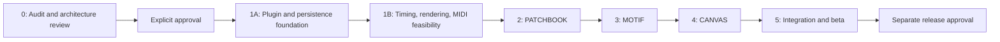

# Development roadmap

Milestone 1A status: Prompt 002 authorized the foundation and a project-local disposable vault. That scope is implemented; see [MILESTONE_1A_REPORT.md](MILESTONE_1A_REPORT.md). G0 is satisfied for 1A only. Milestone 1B remains a separate authorization boundary; all later steps below are plans.

This plan follows the [product acceptance criteria](PRODUCT_SPEC.md#integrated-mvp-acceptance-criteria), [architecture](ARCHITECTURE.md), [data contracts](DATA_MODEL.md), [risk experiments](RISKS.md), and [decision register](DECISIONS.md). It is not an executable implementation plan or permission to modify a vault.

## Sequence and dependencies

Timing/rendering/compiler spikes are small disposable experiments in the authorized development project or a disposable vault; they do not implement a production DAW engine. If they invalidate the proposed stack/envelope, revise the affected decisions before expanding module work.

## Milestone 0 — Research, legacy audit, and architecture

**Deliverables:** source-backed TROUBADOUR inventory/reuse classification, current official research, product/MVP, architecture/data/UI proposals, five risks, milestone plan, agent rules, decisions and final report.

**Validation:** preserve preexisting MNEMOBARD work; audit only the user-authorized legacy location; source path/symbol evidence; distinguish source inspection from historical tests and fresh execution; verify required documents, links, examples and internal consistency; compare legacy tracked hashes/Git status before/after. No plugin code or dependencies added.

**Exit:** documentation is reviewable and limitations are explicit. **Human gate G0:** review architecture/data/MVP and audit; approve or amend choices; authorize Milestone 1 explicitly. Rights/provenance review can block source adoption without blocking approved independent development.

## Milestone 1 — Foundation

### 1A: Host shell and safe records

After approval, initialize local Git, select reviewed Node/tool versions, pin pnpm and dependencies, and create a minimal TypeScript/esbuild plugin with manifest/settings/commands/view factories and appropriate lint/typecheck/test scripts. No remote repository or publication implied. Use a newly created disposable vault only after its path is authorized; never install into an existing personal vault by inference.

Build common schema validation/codec, identity index, conditional repository writes, recovery files, document sessions, typed error results, and disposable lifecycle ownership. Exercise module flags with empty views. Register views before restored workspace activation; postpone expensive indexing/rendering. Do not build full module UIs yet.

**Tests:** R1/R5; malformed/duplicate/future-schema fixtures; prose/unknown metadata preservation; collision-safe creation; conflicting writes; backup failure; stale async completions; enable/disable and workspace restore. Save/reopen in the actual test host.

**Exit:** a sample entity round-trips safely through the real Vault API, index updates incrementally, failed writes preserve reviewable data, and resource teardown works. Record chosen `minAppVersion`, installer/tool versions and dependency notices.

### 1B: Feasibility before feature commitment

Build bounded experiments for R2/R3/R4: source-PPQ import fixtures and a minimal Type1 event writer adapter; a lazy oscillator transport with underrun/seek/cancellation; a culled dense-grid renderer/hit-test harness with keyboard list; a pure repeated-clip compiler. Measure and document limits without building advanced features.

**Exit:** decide whether the proposed dependency, PPQ policy, frame budget and supported envelope are defensible. **Human gate G1:** approve material changes to architecture/scope or lowered support targets. Routine implementation decisions within an already approved milestone do not require repeated permission.

**Legacy adoption proposal:** after L1/L2/L3/L4 authorization in [DECISIONS.md](DECISIONS.md), refactor selected helpers/tests into the new boundaries and validate in isolation. Otherwise independently implement contracts; no schedule assumes source import.

## Milestone 2 — PATCHBOOK

Implement patch create/edit, instrument/preset descriptions, parameter/effect lists, custom tags/search, native note navigation, safe vault attachment links and explicit audio preview. No proprietary preset parser or external instruments. Reuse foundation storage; do not create a separate patch database.

**Dependencies:** 1A storage/identity/settings and 1B media/lifecycle policies.

**Tests/acceptance:** P-01–03, AC-01, relevant AC-06–09; preserve unknown properties/prose, broken attachment states, scoped searching and keyboard controls; validate preview format support and cleanup. Patch note remains useful with plugin disabled.

**Human review G2:** confirm patch workflow and approve the visual direction before final styling. Existing TROUBADOUR style approval does not approve a MNEMOBARD brand. Legacy `searchIdeas` may inform filters; Sound Design Lab is not imported as PATCHBOOK.

## Milestone 3 — MOTIF

Implement note model/controller/UI, note and multiselect commands, keyboard/numeric equivalence, undo/redo, snap/quantization/transposition, fixed tempo/meter, source-PPQ import, explicit motif export, simple synth playback, patch links, and persistence. Render the approved dense-grid design with an accessible list. Defer harmonic engines, additional transforms and recording.

**Dependencies:** foundation grid/audio/MIDI experiments, PATCHBOOK identity links, shared document sessions.

**Tests/acceptance:** M-01–04, AC-02/04/07/08/09/10, R2/R3. Fixture matrix includes 6/8, source PPQ1000, off-grid timing, velocity-zero note ends, unsupported maps, malformed/truncated/oversize data, same-pitch ambiguity, undo boundaries, source immutability, and import warnings. Independent parser and DAW verify exported motif timing/trailing silence.

**Legacy proposal:** math/edit rules and voice/gain logic may shorten development after adaptation. Preserve imported phase and tested race behavior; rebuild DOM rendering and model. Broader transformations remain post-MVP even if old code exists.

**Human review G3:** approve editor usability/performance and any change in musical semantics. No automatic broadening of scope to every legacy feature.

## Milestone 4 — CANVAS

Implement lanes and full-length motif instances with repeat count, contextual patch links, sections/markers/development notes, recording-reference markers, numeric and pointer editing, undo, composition persistence, MIDI-only arrangement preview and Type1 export. Use the same compiler for visual positions, preview and export. Export preflight reports missing/changed records, length violations and channel/pitch conflicts.

**Dependencies:** MOTIF domain and saved records; stable IDs; PATCHBOOK context; foundation compiler/transport; accepted PPQ/channel and live-reference policies.

**Tests/acceptance:** C-01–03, AC-03–08, R4; 16-lane/1,000-instance capped fixtures; repeated-note boundary order; meter/PPQ conversions; live motif-length effects; missing/duplicate records; deterministic export snapshot. Validate DAW tracks, tempo/meter, section markers and silence. Verify recording links are visibly excluded from MIDI preview/export.

**Legacy proposal:** reference `arrangementPlan` repeat/boundary tests but implement new lane semantics. Do not copy section clipping or Type0 encoder as the arrangement exporter.

**Human review G4:** validate planner scope and complete workflow before adding fades/automation or synchronized audio.

## Milestone 5 — Integration and beta

Exercise the complete patch → motif → composition → save/reopen → MIDI workflow. Harden storage/recovery, module-disabled behavior, diagnostics, theme/DPI/keyboard/screen-reader access, and large-vault behavior. Test Linux/Windows/macOS with recorded Obsidian installer versions and media codecs. Verify offline behavior with network blocked and inspect final runtime bundle.

**Acceptance:** all AC-01–10, recorded R1–R5 outcomes, no unresolved data-loss defects, dependency/license/provenance register complete, migration fixtures for any evolved schema, practical onboarding and release notes. Test host restoration with plugin disabled then enabled. Historical TROUBADOUR results do not substitute for MNEMOBARD results.

**Human gate G5:** explicit beta distribution approval, approved license/branding, reviewed support limits and known issues. Publishing, pushing, repository creation, community submission, and changes to existing vaults require the relevant user authorization. None is implied by finishing tests.

## Later milestones

Optional 6: inversion/reversal/rhythmic transformations, richer patch catalogs and metadata, snapshots/pinned motifs if live references prove confusing. Optional 7: waveform regions, visual fades/transitions, MIDI controllers/tempo maps, hardware MIDI and mobile feasibility. Scope each separately. No VST hosting, multitrack audio production engine, or cloud account roadmap is assumed.

## Effort and adoption uncertainty

Planning range for one experienced engineer: foundation/experiments 2–3 weeks, PATCHBOOK 1–2, MOTIF 3–5, CANVAS 3–5, integration/beta 2–3; roughly **11–18 engineer-weeks**, excluding review waits, user research and publishing. These are low-confidence planning ranges, not a delivery commitment. Re-estimate after Milestone 1 measurements.

Authorized legacy extraction may reduce discovery/debugging, but adaptation/tests cost real time. The audit proposes a first adoption tranche of 5–10 engineer-days, not a guaranteed saving. If rights, behavior, or maintenance costs disappoint, independent implementation remains valid without changing the product contract.

## Approval discipline

G0 is required before implementation. Later gates identify meaningful product/scope/release decisions, not permission for every reversible edit or routine test within authorized scope. Record approval evidence and exact scope in [DECISIONS.md](DECISIONS.md). Obtain separate consent for code/fixture extraction, schema migrations, destructive data replacement, final branding, external distribution, and any existing-vault work. Preserve any wider authority explicitly given by the user in a future session.
