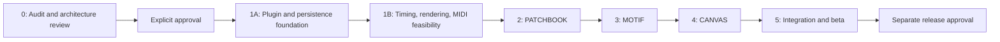

# Development roadmap

Milestone4B implementation and validation are recorded in [MILESTONE_4B_REPORT.md](MILESTONE_4B_REPORT.md). Signed baseline3f5c67f preserves4A;50583e1 preserves3B;90eed00 preserves3A. Arrangement compilation/routing/export/audition are implemented under Prompt009. Stop for human review;4C is not authorized.

This plan follows the [product acceptance criteria](PRODUCT_SPEC.md#integrated-mvp-acceptance-criteria), [architecture](ARCHITECTURE.md), [data contracts](DATA_MODEL.md), [risk experiments](RISKS.md), and [decision register](DECISIONS.md). It is not an executable implementation plan or permission to modify a vault.

## Sequence and dependencies

Timing/rendering/compiler spikes are small disposable experiments in the authorized development project or a disposable vault; they do not implement a production DAW engine. If they invalidate the proposed stack/envelope, revise the affected decisions before expanding module work.

## Milestone 0 — Research, legacy audit, and architecture

**Deliverables:** source-backed TROUBADOUR inventory/reuse classification, current official research, product/MVP, architecture/data/UI proposals, five risks, milestone plan, agent rules, decisions and final report.

**Validation:** preserve preexisting MNEMOBARD work; audit only the user-authorized legacy location; source path/symbol evidence; distinguish source inspection from historical tests and fresh execution; verify required documents, links, examples and internal consistency; compare legacy tracked hashes/Git status before/after. No plugin code or dependencies added.

**Exit:** documentation is reviewable and limitations are explicit. **Human gate G0:** review architecture/data/MVP and audit; approve or amend choices; authorize Milestone 1 explicitly. Rights/provenance review can block source adoption without blocking approved independent development.

## Milestone 1 — Foundation

### 1A: Host shell and safe records

After approval, initialize local Git, select reviewed Node/tool versions, pin pnpm and dependencies, and create a minimal TypeScript/esbuild plugin with manifest/settings/commands/view factories and appropriate lint/typecheck/test scripts. No remote repository or publication implied. Use a newly created disposable vault only after its path is authorized; never install into an existing personal vault by inference.

Build common schema validation/codec, identity index, conditional repository writes, recovery files, document sessions, typed error results, and disposable lifecycle ownership. Exercise module flags with empty views. Register views before restored workspace activation; postpone expensive indexing/rendering. Do not build full module UIs yet.

**Tests:** R1/R5; malformed/duplicate/future-schema fixtures; prose/unknown metadata preservation; collision-safe creation; conflicting writes; backup failure; stale async completions; enable/disable and workspace restore. Save/reopen in the actual test host.

**Exit:** a sample entity round-trips safely through the real Vault API, index updates incrementally, failed writes preserve reviewable data, and resource teardown works. Record chosen `minAppVersion`, installer/tool versions and dependency notices.

### 1B: Feasibility before feature commitment

Build bounded experiments for R2/R3/R4: source-PPQ import fixtures and a minimal Type1 event writer adapter; a lazy oscillator transport with underrun/seek/cancellation; a culled dense-grid renderer/hit-test harness with keyboard list; a pure repeated-clip compiler. Measure and document limits without building advanced features.

**Implemented experiment scope:** exact rational timing and tempo inversion; deterministic note-event compiler; explicit integer projection helper; candidate-library Type0/1 fixture round trips (not a production writer adapter); lazy test-tone transport with pause/resume and cancellation; shared culled grid with pointer/keyboard preview probes; native note and arrangement rectangle benchmarks. The complete accessible list, arbitrary seek UI, production codec, sessions/undo and stored tempo-map editing are deferred. This narrower prototype scope follows Prompt 003's instruction to avoid complete editors/codecs solely for feasibility.

**Evidence:** all original foundation tests plus new feasibility contracts; actual Linux Obsidian native resource checks and bounded benchmarks. All-DOM 20k caused a timeout; SVG-all 20k and dense DOM 20k remain unverified. Cross-platform, screen-reader and long-duration loopback remain open, not implied passes.

**Exit:** decide whether the proposed dependency, PPQ policy, frame budget and supported envelope are defensible. **Human gate G1:** approve material changes to architecture/scope or lowered support targets. Routine implementation decisions within an already approved milestone do not require repeated permission.

**Legacy adoption proposal:** after L1/L2/L3/L4 authorization in [DECISIONS.md](DECISIONS.md), refactor selected helpers/tests into the new boundaries and validate in isolation. Otherwise independently implement contracts; no schedule assumes source import.

**Proposed adoption sequence after review:** first approve PPQ/export warning and fixed-tempo MVP policies, rendering envelope, and strict MIDI adapter evaluation. Build production document-session/undo ownership before musical gestures write data. Proceed to separately authorized PATCHBOOK, then harden shared compiler/codec/transport and accessible grid for MOTIF; CANVAS should consume those same services. Independent implementation is now preferred for the small math/transport modules; no legacy import is needed to proceed. Do not promote `experiments/` wholesale.

## Milestone 2 — PATCHBOOK

### 2A — Production library foundation (Prompt004)

Implemented: standalone instrument and effects-chain notes; compatible patch metadata/UUID relations; structured ordered stages; browser/detail/forms; search with instrument/category/tag/visibility filters; deterministic sorting/pagination; native note/related navigation; shared draft ownership and recoverable conflicts; confirmed archive/restore retaining notes. Existing repository/index/settings/lifecycle remain authoritative. No audio preview or attachment import/management.

Exit evidence: existing/new checks, native create/edit of all three record types, shared chain links, search/filter/sort, scoped keyboard Save, conflicts, rename identity, archive confirmation, module/plugin reload, light/dark/narrow layouts and cold restart. Exact results/limits belong to the2A report, not the planned MVP claims below.

### 2B — Assets, auditioning and recovery (Prompt005)

Implemented: native vault-file selector; destination-confirmed external copy; asset/preset/image inspection and repair; one owned recorded-media preview; explicit checkpoint discovery/inspection/loading and reviewed conflict handling. Existing repository remains authoritative. Native disposable Linux workflow, cold restart, screenshots and100/1000/5000 in-memory benchmarks are recorded in the2B report. No automatic deletion, preset execution or musical editor.

**Exit/review G2:**2B passed report-level review and initial visual review before Prompt006. PATCHBOOK's initial library feature set is present; beta readiness still needs broader compatibility and user review. Prompt006 approves B01–B03 directions for3A, with implementation review; B04, legacy extraction, final branding and release remain unapproved.

Implement patch create/edit, instrument/preset descriptions, parameter/effect lists, custom tags/search, native note navigation, safe vault attachment links and explicit audio preview. No proprietary preset parser or external instruments. Reuse foundation storage; do not create a separate patch database.

**Dependencies:** 1A storage/identity/settings and 1B media/lifecycle policies.

**Tests/acceptance:** P-01–03, AC-01, relevant AC-06–09; preserve unknown properties/prose, broken attachment states, scoped searching and keyboard controls; validate preview format support and cleanup. Patch note remains useful with plugin disabled.

**Human review G2:** confirm patch workflow and approve the visual direction before final styling. Existing TROUBADOUR style approval does not approve a MNEMOBARD brand. Legacy `searchIdeas` may inform filters; Sound Design Lab is not imported as PATCHBOOK.

## Milestone 3 — MOTIF

### 3A — Basic production editor (Prompt006)

Implemented: UUID browser; exact source-tick note editing/chords; Canvas culling and DOM numeric/list alternative; drag/resize/group selection; bounded session undo/redo; grid/off/triplets, zoom/scroll; basic audio-clock sine audition; protected Save and module-specific explicit recovery. Native melody/chord/keyboard/drag workflow survived cold restart.278 tests/26 files and24 native MOTIF groups pass. Twelve screenshots and100/1000/5000/10000-note measurements support review. Same-pitch overlaps and map editing remain unsupported; see the report for all limits.

**Exit/review G3A:** review actual musical usability/screenshots and supported envelope. Broader OS/device/accessibility testing and full-view/aggregate-memory profiling remain necessary. No3B work is authorized by passing these checks.

### 3B — Interchange and targeted editing (Prompt007)

Implemented under Prompt007: strict bounded Type0/1 preview/selection and worker decoding; deterministic Type1 export with independent Python/raw-fixture verification; transpose/start quantize/velocity; exact musical-position editing and PATCHBOOK UUID association/navigation.349 tests/30 files, native workflow/cold restart/regressions,14 screenshots and full-view100/1000/5000 profiles support review. Stateful/unknown events and maps remain blocked; no hardware or multitrack editor.

**Exit/review G3B:** inspect actual interchange fidelity/warnings, musical usability and the5k latency/resource bounds. Milestone4 needs a separate prompt for lane/clip/repetition/channel/export preflight design; passing3B does not authorize CANVAS.

The following original Milestone3 outline describes the eventual combined scope; it does not widen3A authorization.

Implement note model/controller/UI, note and multiselect commands, keyboard/numeric equivalence, undo/redo, snap/quantization/transposition, fixed tempo/meter, source-PPQ import, explicit motif export, simple synth playback, patch links, and persistence. Render the approved dense-grid design with an accessible list. Defer harmonic engines, additional transforms and recording.

**Dependencies:** foundation grid/audio/MIDI experiments, PATCHBOOK identity links, shared document sessions.

**Tests/acceptance:** M-01–04, AC-02/04/07/08/09/10, R2/R3. Fixture matrix includes 6/8, source PPQ1000, off-grid timing, velocity-zero note ends, unsupported maps, malformed/truncated/oversize data, same-pitch ambiguity, undo boundaries, source immutability, and import warnings. Independent parser and DAW verify exported motif timing/trailing silence.

**Legacy proposal:** math/edit rules and voice/gain logic may shorten development after adaptation. Preserve imported phase and tested race behavior; rebuild DOM rendering and model. Broader transformations remain post-MVP even if old code exists.

**Human review G3:** approve editor usability/performance and any change in musical semantics. No automatic broadening of scope to every legacy feature.

## Milestone 4 — CANVAS

### 4A — Arrangement foundation (Prompt008)

Implemented: ordered UUID lanes and parametric saved-motif clips, musical placement/drag/duplication/repetition, shared bounded history, exact source-PPQ preflight, source revision review, native timeline/keyboard controls, safe Markdown save/recovery. No source note arrays are embedded. The compatible contract allows 32 lanes without allocating channels.

Acceptance: pure/model/persistence/UI tests; native four-lane 6/8 workflow, rename/change/missing/inexact sources, conflict/recovery/cold restart and disable/unload checks; actual screenshots; 4/20, 16/200 and 32/1,000 host benchmarks. See [4A report](MILESTONE_4A_REPORT.md).

**Review gate G4A:** approve arrangement usability, live-reference interpretation, exact-only PPQ policy, measured interaction limits and 4B scope. Completion does not authorize 4B.

### 4B — Proposed compilation, transport and interchange

Requires separate authorization. Reuse the pure source summaries/preflight, exact timing helpers and existing musical compiler after review. Establish a coherent captured-source revision set, final channel allocation and same-channel/pitch collision policy before implementing arrangement MIDI export or audio audition. A 32-lane planner does not imply 32 available MIDI channels.

Sections/markers, recording references and related UI require explicitly scoped priorities. Existing schema fields are preserved, but 4A adds no such editor. Do not adopt the old rounded conversion, unique-channel proposal or legacy source automatically. Independently verify any future MIDI output and cancellation/transport behavior.

## Milestone 5 — Integration and beta

Exercise the complete patch → motif → composition → save/reopen → MIDI workflow. Harden storage/recovery, module-disabled behavior, diagnostics, theme/DPI/keyboard/screen-reader access, and large-vault behavior. Test Linux/Windows/macOS with recorded Obsidian installer versions and media codecs. Verify offline behavior with network blocked and inspect final runtime bundle.

**Acceptance:** all AC-01–10, recorded R1–R5 outcomes, no unresolved data-loss defects, dependency/license/provenance register complete, migration fixtures for any evolved schema, practical onboarding and release notes. Test host restoration with plugin disabled then enabled. Historical TROUBADOUR results do not substitute for MNEMOBARD results.

**Human gate G5:** explicit beta distribution approval, approved license/branding, reviewed support limits and known issues. Publishing, pushing, repository creation, community submission, and changes to existing vaults require the relevant user authorization. None is implied by finishing tests.

## Later milestones

Optional 6: inversion/reversal/rhythmic transformations, richer patch catalogs and metadata, snapshots/pinned motifs if live references prove confusing. Optional 7: waveform regions, visual fades/transitions, MIDI controllers/tempo maps, hardware MIDI and mobile feasibility. Scope each separately. No VST hosting, multitrack audio production engine, or cloud account roadmap is assumed.

## Effort and adoption uncertainty

Planning range for one experienced engineer: foundation/experiments 2–3 weeks, PATCHBOOK 1–2, MOTIF 3–5, CANVAS 3–5, integration/beta 2–3; roughly **11–18 engineer-weeks**, excluding review waits, user research and publishing. These are low-confidence planning ranges, not a delivery commitment. Re-estimate after Milestone 1 measurements.

Authorized legacy extraction may reduce discovery/debugging, but adaptation/tests cost real time. The audit proposes a first adoption tranche of 5–10 engineer-days, not a guaranteed saving. If rights, behavior, or maintenance costs disappoint, independent implementation remains valid without changing the product contract.

## Approval discipline

G0 is required before implementation. Later gates identify meaningful product/scope/release decisions, not permission for every reversible edit or routine test within authorized scope. Record approval evidence and exact scope in [DECISIONS.md](DECISIONS.md). Obtain separate consent for code/fixture extraction, schema migrations, destructive data replacement, final branding, external distribution, and any existing-vault work. Preserve any wider authority explicitly given by the user in a future session.

## Milestone4B completion and review gate

Implemented under Prompt009: pure deterministic arrangement compilation, immutable saved-source capture/rechecks, revision-specific review, bounded expansion, deterministic explicit/Auto channel routing, full-provenance collision diagnostics, shared Type1 writer, new-path MIDI exports, and one shared pause/resume/seek audition transport. No schema migration/new dependency. Existing PATCHBOOK/MOTIF behavior and source records are preserved.

Validation:386 baseline tests→449 tests/37files; independent10 valid MIDI fixtures/4 rejection fixtures plus native23-note/five-track comparison; actual Linux Obsidian restart/recovery/conflict/lifecycle and regression workflows;4/20/4,16/200/25,32/1000/100 lane/clip/source benchmarks; actual screenshots. See [the report](MILESTONE_4B_REPORT.md) for conditional limitations, including unverified DAW import and other platforms.

**Stop gate:** human review of4B is required before any4C work. Possible later priorities, not authorized implementation: stronger source-review/diagnostic usability, sections/markers, recording references, pinned-source product policy, more DAW/platform testing, performance/seek continuity refinement. Final channel-wide state/maps/mixing/ports/branding/release and legacy adoption remain separate decisions. No4C code is included.
